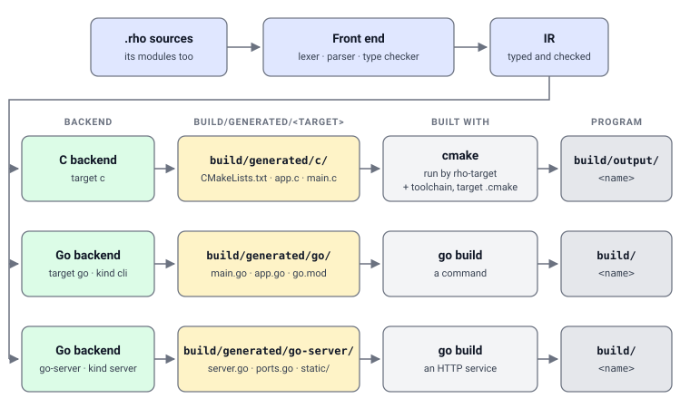

# Build targets

`rho build` turns a project into programs. It compiles the Rho sources once,
writes one generated project per declared target under
`build/generated/<target>/`, and then builds each of those projects with the
toolchain that target's language has: CMake for C, `go build` for Go.



The generated project is ordinary code in an ordinary layout. It can be read, built
by hand, or handed to someone who has never heard of Rho; what `rho build` adds is
that it is always written from the same sources and always built the same way.

## The targets

The targets a build knows come from a descriptor. The built-in one carries three:

| Target | Emitter | Kind | What it produces |
|--------|---------|------|------------------|
| `c` | `c` | `cli` | A CMake project, built into a native program |
| `go` | `go` | `cli` | A Go command |
| `go-server` | `go` | `server` | A Go HTTP service: routes, templates, middleware and a static directory |

A project picks its targets in `module.yml`:

```yaml
build:
  language: go
  targets:
    - go-server
```

A project that names none gets `c`. A project that names several gets every one,
because which backend a program is built with is a property of the project and
not of the machine it is built on. A module with routes still compiles for a
target that is not a server: its `Request` and `Response` types are synthesised
there, which is how a service's handlers are tested on a plain `go` target that
starts no listener.

`build.toolchain` names what the project is built *for*, which is a different
question from which backend it is generated as. It is a target spec of the
{ref}`rho-target/index` component — `native`, `pico`, `esp32c3` — and only the C
target reads it. Nothing named means `native`, the machine doing the build.

## The descriptor

Which files make up each target, and which role each file plays, is data rather
than code: `src/projectgen/descriptor.default.yml` describes the three built-in
targets, and a project changes them without changing the toolchain.

```yaml
version: 1
output_dir: build/generated   # where generated projects go
build_dir: build              # where built programs go

targets:
  - id: go-server
    emitter: go
    kind: server
    files:
      - path: app.go
        role: implementation
      - path: runtime.go
        role: runtime
      - path: server.go
        role: server
      - path: main.go
        role: entrypoint
      - path: go.mod
        role: build
      - path: static
        kind: dir
```

A file names a role, and the backend supplies the content for that role:
`implementation`, `interface`, `runtime`, `entrypoint`, `server` or `build`. A
`dir` entry makes a folder and names no role.

### Changing a target

A project changes a target in one of two places.

**`project.yml`** at the project root is read *on top of* the built-in
descriptor. A target with a built-in id keeps every setting it does not write,
and a key it does write replaces that setting whole, so a project writes only
what is its own:

```yaml
# project.yml
version: 1
targets:
  - id: go-server
    router: serveMux
    ports:
      - logemit
    templates:
      - dir: templates
```

**`build.targets`** in `module.yml` may define a target instead of naming one: an
entry that is a map is a whole target, with its own `emitter` and `files`. It
*replaces* the descriptor's target of the same id rather than overlaying it, so a
manifest definition has to say everything; `project.yml` is the place for a
change to a built-in target.

What a target may say:

| Key | What it is |
|-----|------------|
| `id`, `emitter`, `files` | The target's name, the backend that writes it, and its files (required) |
| `kind` | `cli` (the default) or `server` |
| `description` | A sentence for a person |
| `output_dir` | Where this target's project goes, inside the project |
| `module_path` | The Go module path, when the derived one will not do |
| `requires` | Extra Go module requirements for `go.mod` |
| `ports` | Ports the backend generates — see {ref}`building/ports` |
| `copy` | Hand-written files placed in the generated project (`from`, `to`) |
| `router`, `middleware`, `api` | How a server routes and what wraps it — see {ref}`building/services` |
| `templates`, `locales`, `default_locale` | What a server's pages are made from — see {ref}`building/services` |

## Running a build

```sh
rho build                         # the project in the working directory
rho build path/to/project         # a project directory
rho build src/main.rho            # a file, in the project that holds it
```

| Flag | What it does |
|------|--------------|
| `-target <name>` | Build one target only — see below |
| `-build-type <type>` | `Release` (the default), `Debug`, `RelWithDebInfo` or `MinSizeRel`, matched without regard to case |
| `-link-map`, `-no-link-map` | Whether the link writes its map; `build.link_map` in `module.yml` is the default |
| `-o <file.c>` | Also write the C translation of the Rho program to this file |
| `-clean` | Remove the project's build directory and stop |

### What `-target` names

The flag carries two kinds of name. `c` and `go` are backends: `rho build
-target go` generates and builds the `go` target alone, whether or not the
manifest lists it, which is how a test asks for the one backend it can run.

Any other name is a target spec — a board, a chip, an architecture — and says
what the C target is built for, overriding `build.toolchain`:

```sh
rho build -target pico .     # every declared target; the C one built for a Pico
```

`go-server` is not on the backend list, so `-target go-server` is read as a
target spec and narrows nothing: every declared target is still generated. A
project that wants only its server declares only `go-server`.

### What it writes

| Target | Generated project | Program |
|--------|-------------------|---------|
| `c` | `build/generated/c/` | `build/output/<name>`, with the CMake tree in `build/generated/c/build/<spec>/` |
| `go` | `build/generated/go/` | `build/<name>` |
| `go-server` | `build/generated/go-server/` | `build/<name>` |

`<name>` is the module's name. A project with two Go targets has one binary
name, and the second build replaces the first.

`rho build` also writes `rho.lock` beside the manifest, with what its
dependencies resolved to.

### Building a generated project by hand

The generated projects stand on their own:

```sh
# A Go target
cd build/generated/go && go build .

# A C target, for the host
cd build/generated/c && cmake -B out && cmake --build out
```

`rho build` does more than that for C. It hands the generated project to the
{ref}`rho-target/index` component, which writes `cmake/toolchain.cmake` and
`cmake/target.cmake` into it from the target spec — the compiler, the flags, the
memory map, a linker script — and then configures and builds it. The generated
`CMakeLists.txt` includes the toolchain file before `project()` and the target
file after it when they are there, and a project for the host builds without
them. So a C build needs the `rho-target` component installed and enabled, and
says so when it is not:

```text
rho build: this build needs the rho-target component: module not installed
```

A Go build needs the `go` toolchain. A generated `go.mod` that requires a module
— a router adapter, a database driver — has `go mod tidy` run for it first, and
both run with `GOWORK=off`, because a generated project is often written inside
a repository whose Go workspace does not list it.

## `rho run`

```sh
rho run                    # the project in the working directory
rho run path/to/project
rho run src/main.rho
```

`rho run` builds a program and runs it, in one step and without a C build tree:

- A project with a Go target — `go` or `go-server`, whichever the manifest lists
  first — has it generated and built, and the binary is run from `build/`.
- Otherwise the program is translated to C, compiled with `gcc` into
  `build/run/`, run from the project root, and removed.

A Go program's exit status is the run's; a C program that fails makes the run
exit 1.

## Exit codes

A build that fails because the code is wrong and a build that fails because this
machine cannot try it yet are different facts, and a script running a matrix of
builds needs to tell them apart without reading prose:

| Code | Meaning |
|------|---------|
| `0` | Built |
| `1` | It failed: the program does not compile, a generated project does not build, a tool is missing |
| `2` | It was asked wrongly: a usage error, an unknown build type |
| `77` | It cannot be tried here: a dependency is not fetched, a source a dependency names is absent, a vendor tree a C binding needs is not there |

`77` is the automake convention for "skipped", and the reason is on standard
error. A smoke test that asks whether every example builds for every board reads
it as "not on this machine" rather than as a failure.
