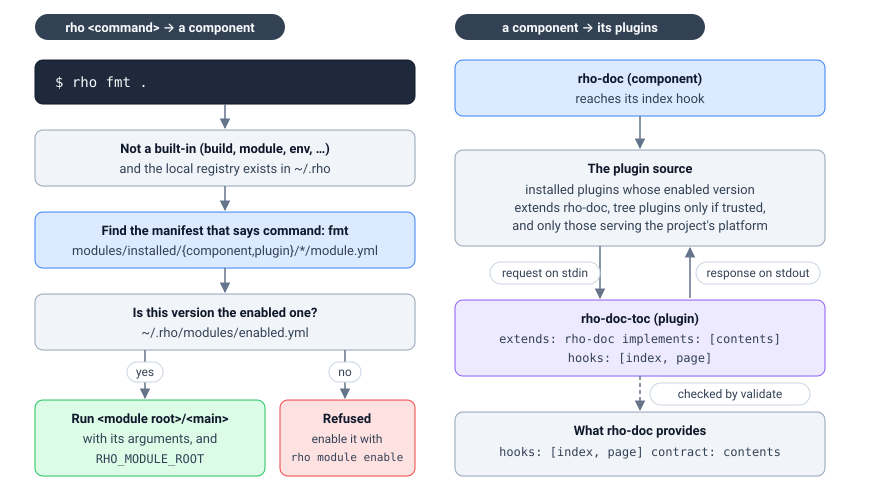

# Components, plugins and contracts

A **component** is a tool: a module that publishes a command, so `rho fmt` works
because the formatter is installed and enabled and its manifest says
`command: fmt`. A **plugin** is an extension of one: it publishes no command a
person types, and it runs only when the component it names runs and asks it
something. The core CLI knows neither by name. Both are modules, installed and
enabled the same way ({ref}`modules/registries`); this page is how each is
declared and how the two meet.



## A component is a tool

```yaml
module:
  name: rho-log
  type: component
  version: 0.1.2
  description: Structured logging
  command: log
  import_path: rho.log

main: rho-log

deps:
  rho-fmt: ">=0.1.0"
```

`main` is a binary in the module's own root, built when the component is
published. A component may also ship a Rho library: `import_path` is the name an
`import` uses, and the library sources travel in the package (its
`package.interface`). That is why `import rho.log` resolves in a project that
depends on `rho-log` without vendoring anything. A component with no
`import_path` is a command and nothing more.

## How `rho <command>` reaches it

A word `rho` does not handle itself — `build`, `module`, `install`, `env` and the
other built-ins are answered first — is looked up among the installed modules:

1. The local registry has to exist (`~/.rho/registry/local/registry.yaml`); if it
   does not, nothing is dispatched.
2. Every `module.yml` under `~/.rho/modules/installed/component/` and
   `.../plugin/` is read, looking for one whose `module.command` is the word.
3. A version that answers is run only if it is the **enabled** version of that
   module (`~/.rho/modules/enabled.yml`). Several versions may be installed, and
   the one that runs is the one somebody turned on, not whichever directory the
   scan reached first.
4. The binary named by `main` is executed from the module's root, with the
   remaining arguments, the terminal's standard streams, and
   `RHO_MODULE_ROOT` set to that root so the component finds the files it carries.

A command whose only installed versions are not enabled is refused with the fix:

```text
rho: the component rho-sql is installed but not enabled, and this is needed to
run; enable it with: rho module enable rho-sql@0.2.2
```

A `main` that is a Rho source rather than an executable is refused too: a module
run as a command is a component with a binary, and a Rho program is built with
`rho build`.

## A plugin is an extension

A plugin names the component it plugs into, the hooks of that component it
answers, and the executables that answer them:

```yaml
module:
  name: rho-doc-toc
  type: plugin
  version: 0.1.0
  description: Adds a table of contents to a documentation site

main: rho-doc-toc

# The component this plugin plugs into.
extends: rho-doc

# What this plugin is, as a contract of that component.
implements:
  - contents

# The hooks of rho-doc it answers.
hooks:
  - index
  - page

# The executables that answer them.
commands:
  - name: table-of-contents
    run: rho-doc-toc
    hook: index
  - name: generation-notice
    run: rho-doc-toc
    hook: page
```

The component says what it offers, which is what that declaration is measured
against:

```yaml
module:
  name: rho-doc
  type: component
  command: doc

provides:
  contracts:
    - name: contents
      description: Adds to a finished set of pages: a table of contents, an API reference, an index.
      one: false
      hooks: [index, page]
  hooks:
    - index
    - page
```

A plugin may extend several components at once, which is what a platform mapping
needs. `extends` is then a list, one entry per component, and a command that
answers only one of them says which:

```yaml
extends:
  - component: rho-target
    implements: [platform]
    hooks: [spec]
  - component: rho-flash
    implements: [platform]
    hooks: [flash]

commands:
  - name: target-spec
    run: acme-platform
    hook: spec
    component: rho-target
  - name: flash-command
    run: acme-platform
    hook: flash
    component: rho-flash
```

## Hooks: how a plugin is called

When a component reaches a hook, it runs every command that answers it, from every
plugin it loaded. A command is a program: the plugin runner writes one JSON
request to its standard input and reads one JSON response from its standard
output.

```json
{"version": 1, "hook": "index", "command": "table-of-contents",
 "component": "rho-doc", "payload": {"...": "..."}}
```

```json
{"version": 1, "payload": {"...": "..."},
 "diagnostics": [{"level": "warning", "message": "..."}]}
```

The envelope is the same for every component; the payload is whatever that
component shows a plugin at that hook, which is why it is typed on the
component's side and documented with it. The program is run from the plugin's
root with `RHO_PLUGIN` and `RHO_PLUGIN_HOOK` set, and has 30 seconds. `run` names
a program the plugin carries, or one on `PATH`; an absolute path, or one that
climbs out of the plugin with `..`, is refused.

A plugin that fails is reported as a warning and skipped: one broken extension
does not cost the rest of the run. A component that holds a plugin across many
requests — a database engine keeping a connection — opens a *session* instead:
the same envelope, one request and one response per line, on a process that
stays up until the component closes it.

## Contracts: what a plugin is for

A hook says how a plugin is *called*. It does not say what the plugin is *for*:
`rho-doc` offers `index`, and both a table of contents and an API reference answer
it while being nothing alike. A **contract** is the other half. A component
declares the contracts it needs a plugin to be, each with the hooks it covers and
how many plugins it expects:

| `one:` | What it says | Example |
|---|---|---|
| `true` | one plugin fills it | `rho-sql`'s `engine` — a service runs its statements against one database |
| `false` | every enabled plugin fills it | `rho-doc`'s `contents` — a set of pages is finished by what each adds |

A plugin names what it fills in `implements`. That is what lets a person decide
whether to turn it on without reading its source: `rho plugin enable` prints each
contract of the component and whether the plugin fills it, and `rho keeper` shows
which contracts are filled. `one:` is a statement for those readers and for the
component; the core does not refuse a second enabled plugin.

A component may declare several contracts, because unrelated jobs are not one
kind of plugin — `rho-test` discovers tests and reports runs, and a plugin that
only reports is not one that discovers:

```yaml
provides:
  contracts:
    - name: discover
      one: false
      hooks: [discover]
    - name: report
      one: false
      hooks: [run]
```

A plugin that names no contract is offered to every run of its component. That is
deliberate: a component whose plugins are all of one kind has no reason to name
them.

## Which plugins a component loads

A component asks for *its* plugins, and gets:

- every installed plugin whose **enabled** version extends this component — an
  installed plugin nobody enabled does not run;
- only if the component was asked to trust them, the plugins the working tree
  carries (`rho doc --tree-plugins`, `rho lint --tree-plugins`). A plugin found in
  a tree came from whoever wrote that tree, which for a fresh clone is a
  stranger, so it is not run by default. An installed plugin wins over one of the
  same name in the tree;
- of those, the ones offered to the project's platform. A plugin that lists
  platforms under `serves:` runs only for a project built for one of them; one
  that lists none runs for any project.

A plugin written for another component is therefore inert rather than handed a
request it cannot answer. `rho doc -list-plugins` names the plugins that extend
the documentation generator, and the ones it found that belong to someone else:

```text
1 plugin(s) extend the documentation generator:
  rho-doc-toc 0.1.0 hooks: index, page
  otherfmt 0.1.0 extends rho-fmt, so this generator does not load it
```

`rho plugin list` answers the same question across the machine:

```text
NAME            VERSION  STATE      EXTENDS   PROVIDES
rho-doc-api     0.1.0    installed  rho-doc   contents
rho-doc-toc     0.1.0    active     rho-doc   contents
rho-sql-sqlite  0.1.0    active     rho-sql   engine
rho-test-junit  0.1.0    installed  rho-test  report
```

## What is checked

The relation is checked when the plugin is validated (`rho module validate`, which
`rho module publish` runs first), rather than discovered from a pipeline that
quietly did less than the plugin was written to do:

| Check | Refused when |
|---|---|
| The plugin names a component | there is no `extends:` (unless it only provides integration data, see {ref}`modules/integrations`) |
| The component exists | it cannot be found installed or in the tree, or it is not a `component` |
| The component offers hooks | its `provides.hooks` is empty |
| Each hook is offered | the plugin declares a hook the component does not offer |
| Each command answers a declared hook | a command's `hook` is not one the plugin declared |
| Each contract is offered | the plugin implements a contract the component does not declare |
| Each hook is inside its contract | a hook falls outside the contracts the plugin claims |
| Only a component offers hooks | a module of another type declares `provides.hooks` or `contracts` |

At run time the runner checks again that a command answers a hook this component
offers, so a run never depends on validation having happened.

## Components that take plugins

| Component | Contracts |
|---|---|
| `rho-doc` | `contents` |
| `rho-test` | `discover`, `report` |
| `rho-sql` | `engine` |
| `rho-lint` | `engine`, `report` |
| `rho-dbg` | `engine`, `register-map` |
| `rho-bench` | `measure` |
| `rho-monitor` | `source` |
| `rho-router` | `spec`, `openapi` |
| `rho-target`, `rho-kconfig`, `rho-cimport`, `rho-flash` | `platform` |

`rho-doc-toc` and `rho-test-junit` are the worked examples, one for each of the
first two; each component's own page documents its hooks and payloads.
