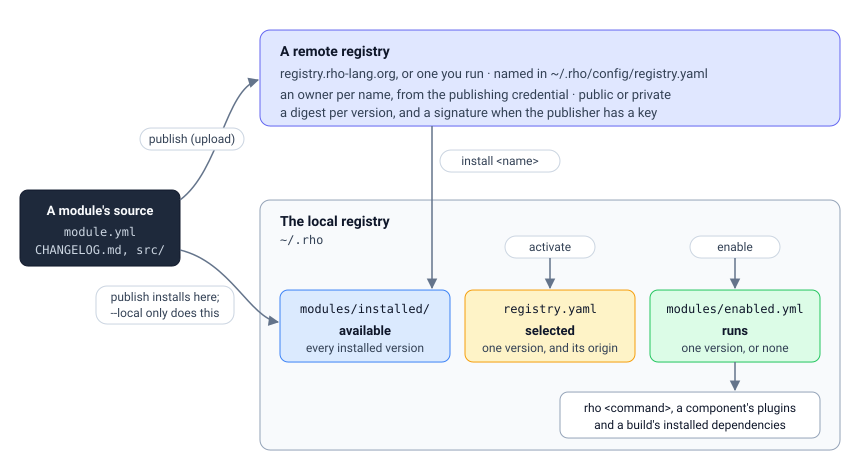

# The two registries

Rho has two registries, and most of the confusion about `rho module` comes from
not knowing which one a command acts on. They are different things with
different authority, and this page is the difference.

| | The local registry | A remote registry |
|---|---|---|
| Where it is | `~/.rho` | A server, named in `~/.rho/config/registry.yaml` |
| Who can change it | you, on this machine | only the module's owner, on that server |
| What it holds | the modules this machine installed | every module anybody published |
| Created by | `rho install` | whoever runs the server |
| Used by the CLI | **only this one** | fetched from, never resolved from |

The rule that makes it simple: **the toolchain only ever uses the local
registry.** A component is dispatched to because its directory is under
`~/.rho/modules/installed` and it is enabled, an installed module resolves as a
dependency for the same reason, and nothing consults a server to decide what a
program may do. A remote registry is somewhere to *fetch from*; what arrives is
installed locally before it can be used.



(modules:local)=
## The local registry

`rho install` creates it. It is the installation:

```text
~/.rho/
  bin/                     rho, rho-deps
  modules/
    installed/             the modules this machine has, by kind
      component/           rho-fmt@0.1.0, rho-log@0.1.2
      plugin/              rho-doc-toc@0.1.0
      module/              Rho libraries and published applications
      library/             modules of an ecosystem's native types
    enabled.yml            which version of each module runs
  registry/local/          registry.yaml: which version is selected, and where each came from
  auth/                    the credential `rho auth login` stored
  cache/                   fetched packages, before they are installed
  config/                  registry.yaml: where the remote registry is
```

Three records describe an installed module, and each answers a different
question:

- **`modules/installed/` is what is available.** A version is installed because
  its directory is there.
- **`registry/local/registry.yaml` is what is known about it**: which version
  the index *selects*, and whether it was published from this machine or fetched.
  The index is reconciled against the tree whenever it is read, so it heals
  rather than drifting: a module removed by hand disappears from it, and one
  installed by something other than `rho module` appears.
- **`modules/enabled.yml` is what runs.** It names, per module, the one version
  that `rho <command>` dispatches to, that a component loads as a plugin, and
  that a build resolves an installed dependency to. A module it does not name is
  installed and not used.

If the local registry does not exist, every command except `help`, `install`,
`init`, `new` and `--version` says so and refuses, because a command that reads
a registry which is not there would fail somewhere deeper with a message about a
file.

(modules:lifecycle)=
## From published to running

Four commands take a module from somebody's source tree to something that runs
here. Each changes one record, and none of them does another's job.

| Command | Changes | What it means |
|---|---|---|
| `rho module publish <dir>` | the remote, then `modules/installed/` and the index | validate, check the exports against the last release, build, pack, upload, and install here |
| `rho module install <name>[@version]` | `modules/installed/` and the index | fetch a version from the remote registry and install it here |
| `rho module activate <name>@<version>` | the index | select which installed version the index records |
| `rho module enable <name>[@<version>]` | `enabled.yml` | choose the version that runs |

**Publish.** `rho module publish <dir>` validates the module, refuses a release
whose exports break the previous one's without a new major version
({ref}`modules/modules`), builds the command when the package carries one, and
packs it. It uploads the package when a remote URL is configured and a credential
is stored, then installs it in the local registry, because a module published
from a machine is on that machine. `--local` skips the upload and only installs,
which is how a release is tried here before it is offered to everybody. Without a
credential the upload is skipped too, and the module is installed locally only.

**Install.** `rho module install <name>` asks the remote registry which version
answers (the newest, unless one is named), downloads the package, checks it
against the digest and any key pinned with `rho module trust`, and unpacks it into
`modules/installed/<kind>/<name>@<version>`, recording it in the index with an
origin of `remote`. Installing again replaces the version, which is also how a
damaged install is repaired. An argument that is a path — `.`, `./x`, or a
directory that exists — installs a project's dependencies instead (below).

**Activate.** The index selects one installed version per module. A module
arriving with nothing selected has its newest version selected; `rho module activate` moves the
selection and `rho module deactivate` steps back to the newest other version. The
selection is what `rho module list` and `search` mark `(selected)`, and what
`uninstall` protects.

**Enable.** Installing a module, by either route, makes it available and nothing
more: **an installed module is not enabled.** A program that ran a module nobody
chose would be running code its author never asked for, on a machine whose state
nobody wrote down. So a component or plugin is used only once somebody enables
it:

```sh
rho module enable rho-sql          # the newest installed version runs
rho module enable rho-log@0.1.0    # this version runs, whichever else is installed
rho module disable rho-log         # stays installed, and is not used
```

`rho plugin enable` and `rho plugin disable` are the same commands, and say what
the plugin will now be asked for ({ref}`modules/plugins`). The components
`rho install` itself puts in place are enabled by it. A command that needs a
module that is installed and not enabled stops and names the command that fixes
it:

```text
rho: the component rho-sql is installed but not enabled, and this is needed to
run; enable it with: rho module enable rho-sql@0.2.2
```

A module that was never installed gets a different message, because the fix is
different — there is nothing to turn on.

The selection and the enabled version are separate records: activating a version
does not make it run, and enabling one does not move the selection. Pinning a
machine to a version known to work is `enable name@version`, and `rho module
list` shows both marks side by side so they can be kept together.

(modules:remote)=
## A remote registry

A remote registry is a service: the `applications/registry` application in this
tree is one, and **Rho's official registry runs it at
https://registry.rho-lang.org**. You point the CLI at it and log in:

```sh
rho config set remote.url https://registry.rho-lang.org
rho auth login
```

Reading a registry is public: `rho module install` and `download` need no
credential. `rho module search` reports what is installed here and then, when a
credential is stored, what the remote has, under a heading of its own so a module
this machine does not have is never mistaken for one it does. Publishing presents
a token, which is what `rho auth login` obtains. A registry you run yourself is
pointed at the same way, with its own URL.

The credential is stored in `~/.rho/auth/`, and every operation that needs to
know who you are presents it. That is what makes the owner of a module
knowable: **the registry records the identity in the token, not the name in the
manifest.**

(modules:ownership)=
## Who owns a module

A module's manifest names an author, in the author's own words:

```yaml
module:
  name: acme-router
  author: Ada Example
  maintainer: Ada Example
  visibility: public
```

That name is what a reader sees and what a maintainer puts in a release note. It
is **not** what the registry checks, because a name in a file is not a
credential. What it records, the first time a name is published, is the identity
in the credential:

```json
{"name": "acme-router", "owner": "ada", "maintainers": ["ada"],
 "visibility": "public", "firstPublished": "2026-09-28T10:07:00Z"}
```

The owner is recorded against the **name**, not a version, which is what stops a
re-publish from taking a module over: whoever publishes 0.2.0 cannot become the
owner by publishing it.

- Only the owner (and a maintainer, which is the same identity for now) may
  publish another version.
- Only the owner may withdraw a version or change its visibility. Withdrawing is
  the destructive one — a module that is gone cannot be resolved against, and
  every project depending on it stops building — so it is kept with one identity
  rather than with everyone who can add to the module.

A publish needs a credential on any registry, secured or not. An open registry
serves its modules to anyone; it does not *accept* a module from anyone, because
a module nobody can add a version to or withdraw is stuck the moment it is
published.

A publisher who has made a key with `rho module keygen` signs each package's
digest, and an installer that pinned that key with `rho module trust` refuses a
package signed by anyone else. A publish without a key goes out unsigned, and
says so.

(modules:visibility)=
## Public and private

A module is public — anybody may install it — unless its owner says otherwise.
A private module is its owner's alone:

- a stranger cannot install it, and gets the same "not found" a module that does
  not exist gets, so a private name cannot be mapped by watching which names
  answer differently;
- it is not in a search for anybody but its owner;
- its owner can still see it, and install it, and make it public again.

```sh
rho module mine                       # what you published, and its state
rho module visibility orders          # what it is now
rho module visibility orders private  # make it yours alone
rho module visibility orders public   # offer it to everybody
```

`mine` exists because a private module is deliberately absent from what
everybody else can see, so it is the only way its owner finds it.

(modules:commands)=
## The commands

Split by which registry they act on, because they are different operations with
different guards.

**The local registry** — about this machine, and needing no authority over
anybody:

| Command | What it does |
|---|---|
| `rho module install <name>[@version]` | fetch from the remote registry and install here |
| `rho module uninstall <name>[@version]` | remove a version from here; `--all` removes every version |
| `rho module activate <name>@<version>` | select the version the index records |
| `rho module deactivate <name>@<version>` | step back from that selection |
| `rho module enable <name>[@<version>]` | choose the version that runs |
| `rho module disable <name>` | keep it installed, and stop using it |
| `rho module list [query]` | what is installed here, selected and enabled |
| `rho module search [query]` | what is installed here, and what the remote has |

**A remote registry** — about other people, and needing to be the module's
owner:

| Command | What it does |
|---|---|
| `rho module publish <dir> [--local]` | pack a module, upload it, and install it here; `--local` installs only |
| `rho module unpublish <name>@<version>` | withdraw a version |
| `rho module visibility <name> [public\|private]` | show or change who may install it |
| `rho module mine [query]` | the modules you published |
| `rho module keygen` | make the key you sign what you publish with |
| `rho module trust <name\|*> <key>` | pin the key a module must be signed by when installed |

`unpublish` does not remove the local copy: withdrawing a module from a registry
is a different act from removing it here, and a user who asked for the first did
not ask to lose the second. It says so when the version is still installed.

(modules:uninstall-rule)=
## Why uninstall asks you to deactivate first

The selected version is the one the index records for a module. Removing it would
move that record to a different version without anyone asking, so it is refused
until it is deactivated:

```console
$ rho module uninstall rho-log@0.1.0
rho module uninstall: rho-log@0.1.0 is the selected version; deactivate it
first (rho module deactivate rho-log@0.1.0)
```

The one exception is the last version installed: with nothing else there is
nothing to fall back to, so removing it is the point rather than a change anyone
would notice. Uninstalling the enabled version leaves the module with nothing
enabled; enable another version to use it again.

Deactivating one version of several moves the selection to the newest version
that is left, so the index never selects nothing while something is installed.

(modules:workflow)=
## The whole thing, end to end

```sh
# You have cloned the repository and built rho. Install the toolchain, which
# creates the local registry and enables the components it carries.
rho install

# Build a component and install it here, without uploading it.
(cd modules/components/rho-fmt && go build -o rho-fmt ./src)
rho module publish modules/components/rho-fmt --local
rho module enable rho-fmt

# Point at the official registry and log in, so publishes are attributed to you.
rho config set remote.url https://registry.rho-lang.org
rho auth login

# Publish something. The manifest names the author; the token says who you are.
rho module publish modules/acme-router

# On another machine, or after clearing your local registry:
rho module install acme-router       # fetched and installed
rho module enable acme-router        # and now it runs
rho module list acme-router
```

## Project dependencies

A project resolves its own dependencies separately, and keeps them in
`rho.lock`:

```sh
rho module install       # resolve and install what module.yml declares
rho module update        # move them to what a registry now offers
rho module remove <name> # drop one from the project
```

Each package is checked against the digest the registry recorded for the
version, so a package altered where it is kept is refused rather than installed.
The digest is written into the lock beside the version:

```yaml
lock:
  math: "1.2.0"
sha256:
  math: "…"
```

The version says what to install, and the digest says which bytes that version
was. How a dependency is found once it is there is in {ref}`modules/modules`.
